# FEAT-009: Kestrel terminal redesign — panel states, start screen, conversation, council views

- **ID:** FEAT-009
- **Status:** Proposed. Design approved by the owner on 2026-10-29; not yet selected for execution.
- **Suggested execution task:** `KESTRELUX-001` (split into the phases in §8 if useful)
- **Priority:** High
- **Category:** UX / Agent panel / Council
- **Depends on:** FEAT-002 council (merged in `d06cabf`). It does **not** require agent changes; §9 lists the parts of the mockups that would.

---

## 1. Summary

Rebuild Kestrel's chat to match the FinSight terminal look, in both dark and a new light mode:

1. **Three panel states** that never cover the main terminal: a collapsed **capsule**, the existing **side panel**, and a new **full page**.
2. **Start screen** (concept "A+B+C"): centred ask box, briefing tiles, suggestions, recent chats, shortcut hints.
3. **Conversation** (concept "A+B+C"): log-style tool steps, streamed answer, and a **workspace column** for charts and tables when Kestrel is full page.
4. **Council full page** with a **Cards / Chain of thought** switch, a compact council inside the side panel, and a council status inside the capsule.
5. **Motion** that follows real run state only, with reduced-motion and off-screen pausing.

---

## 2. Design references (read these first)

Everything needed is in this repo, in [`FEAT-009-assets/`](FEAT-009-assets/); no external access is required. See its [README](FEAT-009-assets/README.md).

- **Screenshots**: `FEAT-009-assets/screens/*.png`, embedded below.
- **Design source**: `*.dc.html`. This is plain HTML with inline styles; a `renderVals()` script at the bottom holds the sample data and theme tokens. Each file opens directly in a browser through the bundled `support.js`, is clickable, and takes URL parameters for theme and state, e.g. `KestrelCards.dc.html?theme=light&stage=done`. Read them for exact layout, spacing, colours, copy and motion, then rebuild the screens in React.

### Screens

| | Dark | Light |
|---|---|---|
| Start screen (§5.1) | 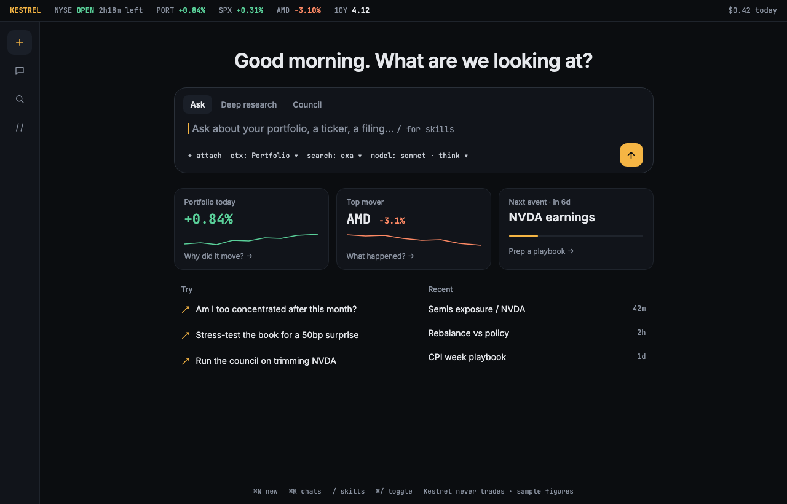 | 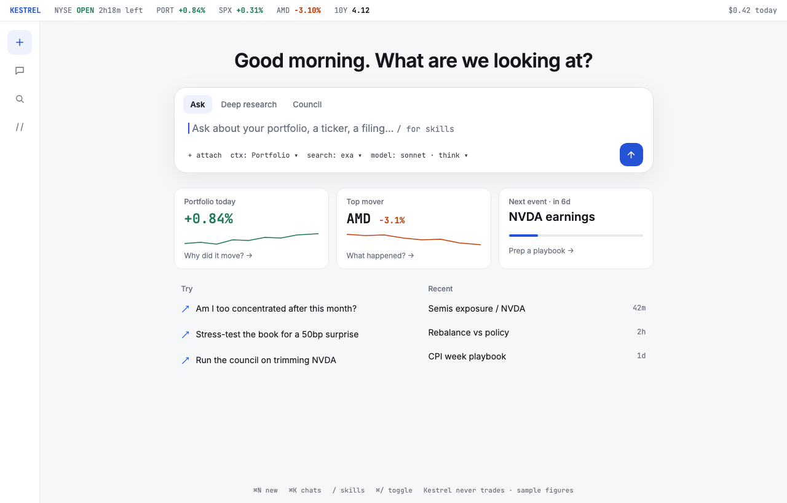 |
| Conversation, full page with workspace (§5.2) | 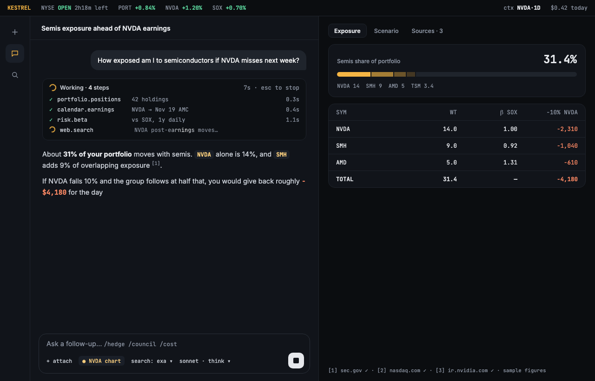 | 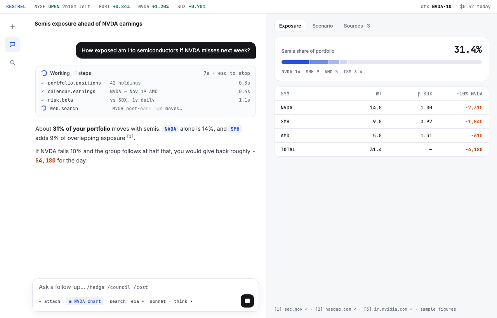 |
| Side panel with compact council (§4, §6.4) | 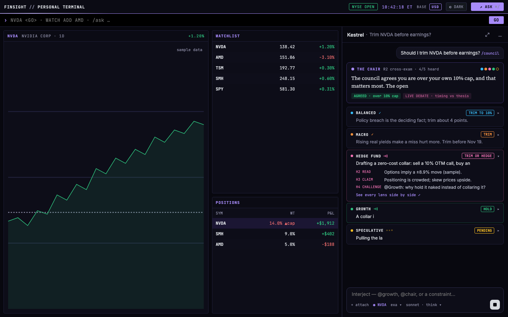 | 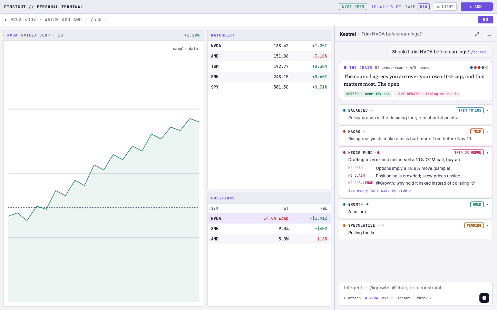 |
| Collapsed capsule (§4) | 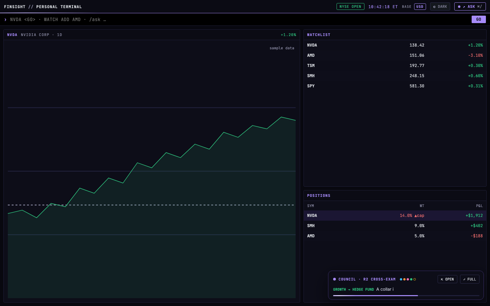 | 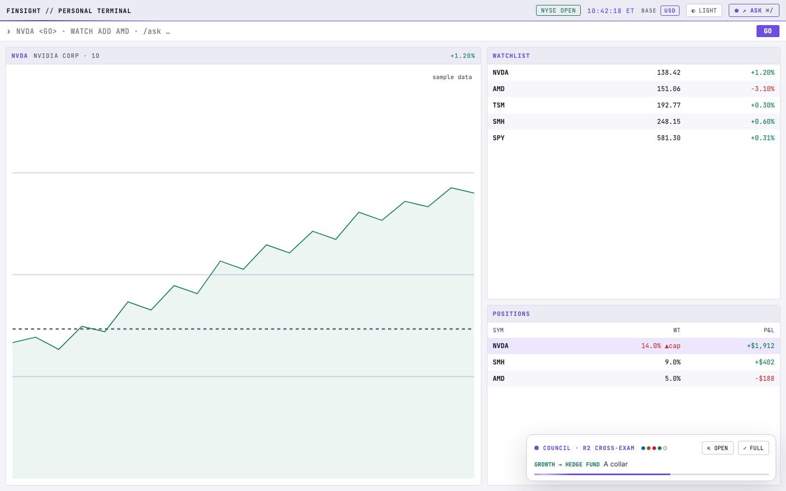 |
| Council, Cards, running (§6.2) | 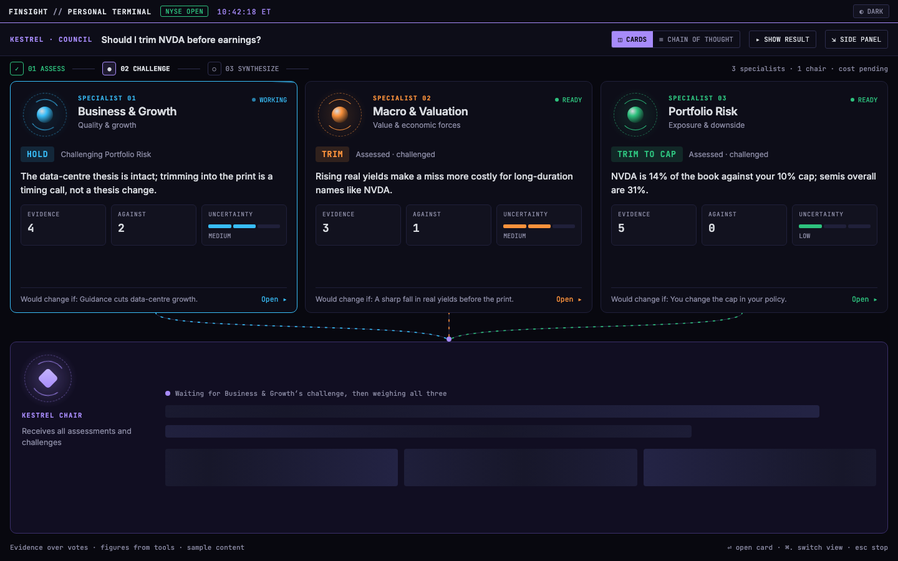 | 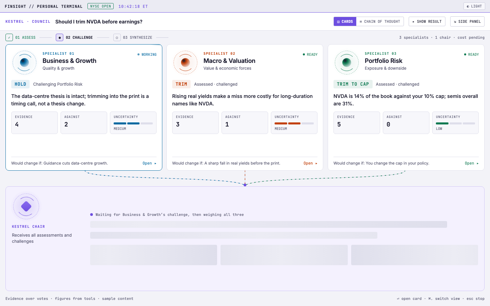 |
| Council, Cards, done (§6.2) | 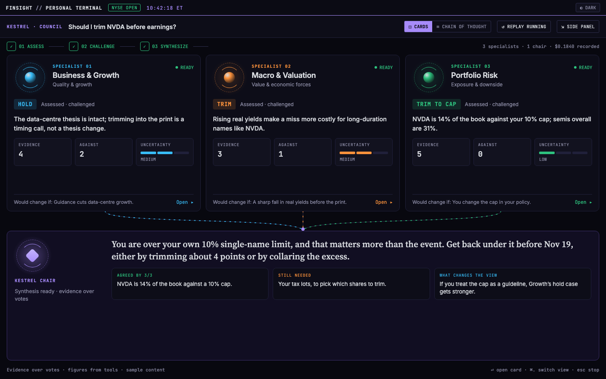 | 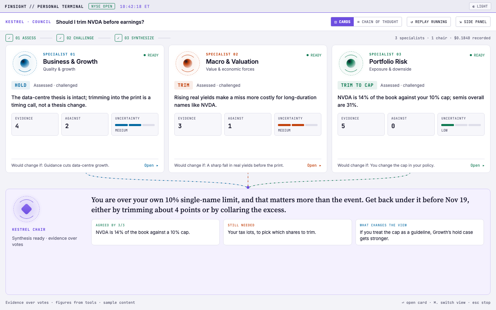 |
| Council, Chain of thought (§6.3; the mockup shows 5 lenses, build 3 + Chair) | 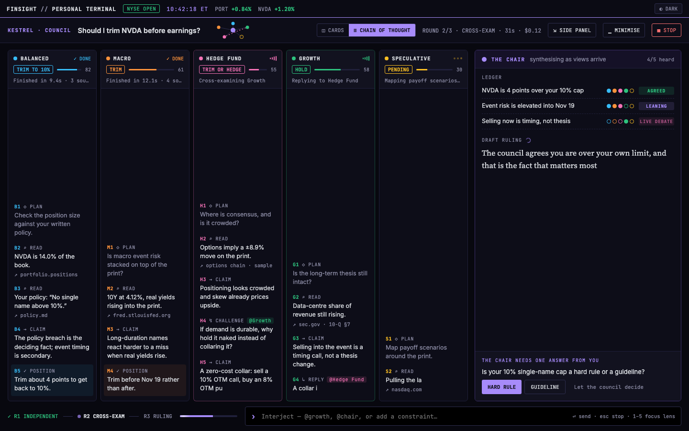 | 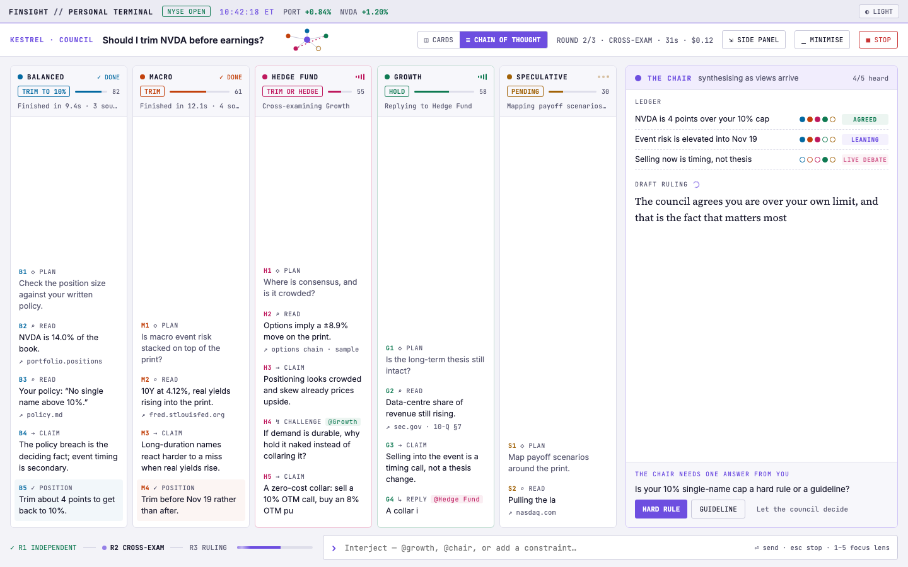 |

The screenshots are single frames. For motion, open the `.dc.html` files; §3.4 lists every animation.

The start screen and conversation mockups use a generic light/terminal palette and an Inter-style UI. When you build them, use the FinSight tokens in §3 (as the Kestrel* files do). Keep their layout and components.

| File | Shows | Interactive bits in the mockup |
|---|---|---|
| [`KestrelSide.dc.html`](FEAT-009-assets/KestrelSide.dc.html) | FinSight terminal + Kestrel **side panel** with compact council; the **collapsed capsule** | ↗ ASK toggles side ↔ capsule; ▁ collapses; ⇱ re-opens; lens rows expand |
| [`KestrelCards.dc.html`](FEAT-009-assets/KestrelCards.dc.html) | Council full page, **Cards** view, running and done states | Click a card to widen it; ▸ SHOW RESULT toggles the Chair's result |
| [`KestrelFull.dc.html`](FEAT-009-assets/KestrelFull.dc.html) | Council full page, **Chain of thought** view with the Chair column | Click a lane header to focus it; streaming text loop |
| [`MergedStart.dc.html`](FEAT-009-assets/MergedStart.dc.html) | Start screen | `theme` tweak: light / terminal |
| [`MergedChat.dc.html`](FEAT-009-assets/MergedChat.dc.html) | Conversation with workspace column and running tool steps | `theme` tweak: light / terminal |

These local files are the source of truth. The owner also keeps a private design canvas, but you don't need it.

> **The sample content in the mockups is invented.** Tickers, weights, P&L, quotes, sources and costs are illustrative only. In the product, every number comes from tool output (AGENTS.md §2.3) and every finding from the council contract.

**Important: the mockups go beyond today's data.** `KestrelFull.dc.html` and the side-panel council show **five lenses** debating with **typed-out live reasoning**. The real council has **three specialists plus the Chair** and only sends run status and a structured result (§6.1). Build to the real data; §6 maps every element, and §9 lists what is deferred.

---

## 3. Design system

### 3.1 Colour tokens

Dark = the existing `:root` violet theme in [`public/styles.css`](../../public/styles.css). Light is new. The accent presets (`data-theme="amber" | "teal" | "phosphor"`) stay; light mode is a separate, orthogonal switch (§7).

| Token | Dark (existing) | Light (new) | Use |
|---|---|---|---|
| `--bg` | `#08080f` | `#f3f3f8` | page |
| `--panel` | `#0d0d18` | `#ffffff` | cards, panels |
| `--panel-2` | `#12121f` | `#f7f7fb` | card headers, tiles |
| `--head` | `#0b0b14` | `#ebebf3` | top bar, table heads |
| `--border` | `#20203a` | `#dedeea` | hairlines |
| `--border-2` | `#2d2d4d` | `#c8c8da` | controls, emphasis |
| `--text` | `#d7dadf` | `#16162a` | body |
| `--muted` | `#7e7e96` | `#5a5a72` | secondary (≥4.5:1 on `--panel`) |
| `--dim` | `#85859e` | `#5f5f78` | tertiary |
| `--amber` (accent) | `#a78bfa` | `#6d4ee0` | brand accent; the name is legacy |
| `--amber-2` | `#c4b5fd` | `#5a3dc8` | accent text on panels |
| `--up` | `#2ec27e` | `#0b6e49` | gains, done (darkened from the mockup's `#0f7a52` to pass 4.5:1 on `--selected`) |
| `--down` | `#f87171` | `#b3302f` | losses, stop (darkened from `#c93434` to pass 4.5:1 on `--head`) |
| `--cyan` | `#38bdf8` | `#0369a1` | Business & Growth role |
| `--tint` | `rgba(167,139,250,.10)` | `rgba(109,78,224,.08)` | soft accent fill |
| `--glow` | `rgba(167,139,250,.30)` | `rgba(109,78,224,.22)` | focus, hover |
| `--selected` | `#1b1633` | `#ece7fd` | selected row |

Each accent preset needs a light variant too: keep its hue and darken it until accent text passes 4.5:1 on `#ffffff` and on `--head`. As built: amber `#a14a08` / `#8a3e06`, teal `#0f766e` / `#115e59`, phosphor `#166534` / `#14532d`.

**Role colours** (council). As built they are `--kx-growth`, `--kx-macro` and `--kx-risk` in `agent-panel.css`, falling back to `--cyan` / `--amber` / `--up`. The values:

| Role | Dark | Light |
|---|---|---|
| Business & Growth (`growth`) | `#38bdf8` | `#0369a1` |
| Macro & Valuation (`macro`) | `#fb923c` | `#b33d0b` |
| Portfolio Risk (`risk`) | `#2ec27e` | `#0b6e49` |
| Kestrel Chair (`chair`) | accent | accent |

Soft fills are the role colour at about 14–22% alpha in dark and 8–14% in light.

### 3.2 Type

- **Chrome, data, labels, steps:** the active `--font` (SF Mono / JetBrains Mono stack). Use uppercase with letter-spacing `.6–1.2px` for eyebrows such as `KESTREL · COUNCIL` and `THE CHAIR`, and tabular numerals throughout.
- **Chat UI text:** `--kx-font` (system sans), 13–14.5px.
- **Reading text** (the Chair's ruling, long answers): `--kx-read` (Kestrel Serif / Source Serif 4, already shipped in `/fonts`), 14.5px in the side panel and 16–21px full page.
- **No new fonts in the product.** The mockups bundle Inter and JetBrains Mono (in `FEAT-009-assets/fonts/`) only to render offline as stand-ins for the system stacks (§11.2).

### 3.3 Shape and spacing

- Terminal chrome (top bar, buttons, chips, stage boxes): **3px** radius, matching `.pill` and `.topbar-btn`.
- Kestrel cards: **6–10px**; composer **10–16px**; the capsule **12px**.
- Spacing steps are 4 / 6 / 8 / 10 / 12 / 14 / 16. Panels sit 10px apart, as in the `.grid` gap.
- No gradient washes, no left-border accent cards, no emoji in the UI.

### 3.4 Motion tokens

| Name | Value | Used for |
|---|---|---|
| `--kx-ease` | `cubic-bezier(.2,.8,.2,1)` | arrivals, column and card resizes |
| `--kx-ease-pop` | `cubic-bezier(.2,.9,.3,1.2)` | capsule pop-in, done badges |
| arrive | 400–600 ms, translateY 8–16px plus fade | new steps, cards, results |
| resize | 450 ms flex transition | focusing a lane or opening a card |
| spinner | 0.8–1.1 s linear | a run is working |
| orb rings | 9 s and 2.4 s counter-rotating | specialist / Chair working |
| ping | 1.8 s scale 1 → 2.6, fade out | the Chair or capsule is live |
| flow | 1–1.4 s dash offset | evidence flowing into the Chair |
| sweep | 1.6–1.8 s translateX | progress bars, top-bar activity line |
| shimmer | 1.8 s background-position | Chair placeholders while waiting |

Rules:
- An animation runs **only while the state it shows is true** (a run is `running`, the Chair is waiting, and so on). Never animate idle or finished items, except a one-off arrival.
- `prefers-reduced-motion: reduce` turns every loop off and keeps the final, static state.
- Keep the existing **pause when off-screen or the tab is hidden** pattern (`data-visible`, as in `CouncilBoard`).

---

## 4. Panel states

```
CAPSULE (panel closed, a turn or council is running)     SIDE (existing drawer, restyled)          FULL PAGE (new)
┌───────────────────────────────────────────────┐        ┌─────────────────────────┬───────────┐   ┌───────────────────────────────────┐
│ FINSIGHT // …            NYSE OPEN  ↗ASK⌘/ ●  │        │ FINSIGHT top bar        │ Kestrel ⤢▁│   │ FINSIGHT top bar (kept)           │
│▔▔▔▔▔▔▔▔▔▔▔ activity sweep line ▔▔▔▔▔▔▔▔▔▔▔▔▔▔▔│        │ › command bar           │ chat …    │   │ KESTREL · <title>  ◫|≡  ⇲  ▁  ■   │
│ › command bar                                 │        │ terminal grid narrows,  │           │   │ conversation  │  workspace         │
│ terminal grid (full width, untouched)         │        │ never covered           │ composer  │   │ or council page                    │
│                          ┌──────────────────┐ │        └─────────────────────────┴───────────┘   └───────────────────────────────────┘
│                          │● COUNCIL · R2 … ⇱⤢│ │
│                          │ line in progress │ │
│                          │▬▬▬▬▬▬▬░░░░ progress│ │
│                          └──────────────────┘ │
└───────────────────────────────────────────────┘
```

- **Side:** the existing drawer (`body.agent-open`, resizable `--agent-w`). It narrows the terminal; it never overlays it. Header controls: ⤢ full page, ▁ collapse, plus the existing controls. The dock mode stays as it is.
- **Capsule:** shown only while the panel is closed **and** a turn is running. It sits fixed at bottom-right (18px inset), is 430px wide, and has `role="status"`. It shows:
  - the round or step label
  - role dots (filled = done, outline = pending)
  - one line of the latest real event (for example "Portfolio Risk finished", or the current tool name)
  - progress
  - ⇱ (open side) and ⤢ (open full).

  When nothing is running, the closed state is just the ↗ ASK button. The ASK button shows a pulsing dot, and a 2px accent sweep runs under the top bar, while work runs with the panel closed.
- **Full page:** covers the area below the FinSight top bar, which stays visible. Header controls: ⇲ back to side, ▁ capsule, ■ stop. Esc returns to the previous state when the composer is empty, matching the existing behaviour.
- **Persistence:** add `full` to the panel state and save it in `localStorage` next to `LS.mode` and `LS.collapsed` ([`labels.ts`](../../web/src/features/kestrel/labels.ts)). A reload restores side and capsule; it shows full page as side, so the terminal is visible first.
- **Keyboard:** keep `⌘/` (toggle). Add `⌘⇧/` for full page and `⌘.` to switch Cards / Chain of thought in the council page; show both in tooltips. Focus moves to the composer on open and back to the ASK button on close.
- **Transitions:** the side panel slides in 400ms from +24px plus fade (`slidein`); the capsule pops in (`popup`); full page fades and scales from 0.985 in 250ms.

---

## 5. Start screen and conversation

### 5.1 Start screen (`MergedStart.dc.html`)

```
greeting (32px)                         market status
┌──────────────── ask box ─────────────────────────┐
│ [Ask] [Council]                                   │
│ ▌ Ask about your portfolio, a ticker…  / skills  │
│ + attach  ctx: <page> ▾  search ▾  model·think ▾ ⬆│
└───────────────────────────────────────────────────┘
[Portfolio today ⌁]  [Top mover ⌁]  [Next event ▬▭]
Try …                            Recent …
⌘N new · ⌘K chats · / skills · ⌘/ toggle · Kestrel never trades
```

Map it onto the existing `Welcome` in [`Chat.tsx`](../../web/src/features/kestrel/Chat.tsx):
- **Greeting and market:** `greeting()` and `usMarket()`.
- **Tiles:** the existing `Briefing` (portfolio, top mover, next event with `Spark` and the countdown bar). Each tile becomes a button that sends its matching ask, as shown in the mockup.
- **"Try":** `asks()` (the frozen-cards behaviour stays).
- **"Recent":** the jump list, with its delete affordance.
- **Mode tabs:** "Ask" plus "Council" only when `s.council` is on; the tab sets the council toggle and lens. Drop the mockup's "Deep research" tab unless a real mode exists.
- **Pickers:** the composer pickers move inline as small mono buttons (`ctx`, `search`, `model · think`).
- **Ticker strip:** show it only if it can be built from existing queries (`usePortfolio`, `useIntraday`). Otherwise leave it out; never hard-code symbols.

### 5.2 Conversation (`MergedChat.dc.html`)

- **User message:** a right-aligned bubble (dark bubble in light mode, `--panel-2` in dark mode).
- **Tool steps:** `ToolGroup` becomes a log card:
  - the header shows a spinner and shimmering "Working · N steps", or "Used N tools"
  - each row is `✓ name  args … 0.3s`, using `prettyArgs`; a running row has a spinner and shimmering args; a failed row has `✕` in `--down`
  - rows arrive with a 150ms stagger
  - the card stays collapsible, as today.
- **Answer text:** markdown, as today. Ticker mentions get mono chips (`--tint` background, accent-2 text) only where the markdown renderer already identifies them; don't add guesswork. While streaming, a blinking block caret follows the last character.
- **Citations and meta:** keep the existing classes (verified, unverified) and buttons (copy, trace).
- **Workspace column (full page only):** `ui` parts (`UiView`) and chart views render in a right-hand column with tabs per view plus a "Sources · N" tab, instead of inline. In the side panel they stay inline. Copy and trace behave as before.

---

## 6. Council

### 6.1 Real data (what the UI may show)

Each `council` part ([`turns.ts`](../../web/src/features/kestrel/turns.ts)) is one run:
- `role` ∈ `growth | macro | risk | chair`
- `phase` ∈ `assessment | challenge | synthesis`
- `status` ∈ `running | completed | failed | stopped`
- `model`, `costUsd`, `ms`
- `detail` = JSON of `Assessment` when completed, otherwise the error text.

`Assessment` ([`council-contract.ts`](../../agent/src/chat/council-contract.ts)) contains:
- `findings[]`, each with `claim`, `evidenceIds[]`, `assumptions[]`, `uncertainty` (free text), `counterevidence[]`, `invalidation` and `missingEvidence[]`
- `unresolvedQuestions[]`.

There is **no** streamed reasoning, stance, agreement vote or numeric confidence. `addCouncil` deliberately never exposes model scratch reasoning, and that must stay true. **UNPEEK** (`store.peek === false`) hides every finding, claim and question in every view, including the capsule line and copy output.

Reuse the existing logic: `councilState()` for status, the `phase` / `stageDone` logic for stages, `CouncilConclusion` for the final result, and `copyAnswer` UNPEEK handling.

### 6.2 Cards view (`KestrelCards.dc.html`)

```
01 ASSESS ✓ ── 02 CHALLENGE ● ── 03 SYNTHESIZE ○                3 specialists · 1 chair · cost
┌ Business & Growth ─────┐ ┌ Macro & Valuation ─────┐ ┌ Portfolio Risk ────────┐
│ (orb)  SPECIALIST 01   │ │ (orb)                  │ │ (orb)                  │
│ status · phase note    │ │                        │ │                        │
│ claim (first finding)  │ │                        │ │                        │
│ [EVIDENCE n][AGAINST n]│ │                        │ │                        │
│ [UNCERTAINTY text]     │ │                        │ │                        │
│ Would change if: …  ▸  │ │                        │ │                        │
└───────────┬────────────┘ └───────────┬────────────┘ └───────────┬────────────┘
            ╰──────────────── animated flow ──────────────────────╯
┌ KESTREL CHAIR (orb) ── waiting: shimmer placeholders  │  done: serif ruling + 3 result cards ┐
└───────────────────────────────────────────────────────────────────────────────────────────────┘
```

| Element | Source |
|---|---|
| Stage boxes | the existing stage logic; ✓ done, ● current (accent), ○ pending |
| Card status | `councilState(runsForRole)` → WORKING / READY / FAILED / STOPPED / QUEUED / NOT RUN |
| Phase note | "Forming an independent assessment" / "Testing the other assessments" / "Assessed · challenged" (from `phase`, as `CouncilBoard` does today) |
| Claim | first finding's `claim` of the latest completed run for the role; placeholder copy while running (reuse the existing strings) |
| EVIDENCE | number of unique `evidenceIds` across that run's findings |
| AGAINST | number of `counterevidence` items |
| UNCERTAINTY | the first finding's `uncertainty` text, clamped to 2 lines. **No gauge**, because the contract has no level (§9) |
| "Would change if" | first finding's `invalidation` |
| Open card | widens to `flex: 1.9`, showing: ASSUMES (`assumptions`), OPPOSING EVIDENCE (`counterevidence`), STILL NEEDED (`missingEvidence`), CHALLENGE ROUND (the challenge run's first claim), plus model, time and cost per run, and the full `CouncilActivity` list below |
| Stance chip | **leave out** for now (§9). Use a role eyebrow (`SPECIALIST 01`) instead |
| Chair, waiting | the orb animates; the line says what it is waiting for, derived from which runs are still `running`; 2 shimmer lines plus 3 shimmer tiles |
| Chair, done | the serif lead is the Chair's first finding `claim`; the three tiles are "Still needed" (merged `missingEvidence`), "What changes the view" (`invalidation`s) and "Open questions" (`unresolvedQuestions`). Keep "Full report & source references" (`CouncilConclusion` children) |
| Failed or stopped | the card border uses `--down`; the stage stays incomplete; the header title says "Review ended with gaps", as today |

Motion: orbs and the top sweep animate only for `running` roles. Flow lines animate only while any specialist or the Chair is running. Cards arrive with an 80ms stagger. A card that finishes gets the `pop` done badge once.

### 6.3 Chain of thought view (`KestrelFull.dc.html`), adapted to real data

The mockup has 5 lanes of live reasoning. Build **4 lanes: 3 specialists plus the Chair column**, made of **real steps** in arrival order:

| Step tag | Comes from |
|---|---|
| `◇ ASSESS` | an assessment run started (status `running`; a spinner row) |
| `→ CLAIM` | each `finding.claim` of a completed assessment run (`G1`, `G2` … numbered per role) |
| `⌕ EVIDENCE` | the finding's `evidenceIds` as chips; resolve the source host if the evidence notice (`council_evidence`) is available on the turn |
| `↯ CHALLENGE` | a challenge run started or finished, plus its claims |
| `✕ GAP` | a failed or stopped run, with its error text |

- **Lane header:** role dot, name, live-state indicator (spinner = running; ✓ = completed; ✕ = failed), and a status line ("Finished in 9.4s · 3 evidence" from `ms` and the counts).
- **Click a lane to focus it** (`flex: 2.6`); the others collapse to their last 2 steps with "+ N earlier steps".
- **Chair column:**
  - a "Ledger" listing the claims from the challenge round (the claim text only, with a dot for its role) — no vote dots (§9)
  - "Draft ruling", which appears when the synthesis run completes; before that, shimmer
  - "The Chair needs one answer from you": the first `unresolvedQuestions` item, with a button that puts the question into the composer. The mockup's HARD RULE / GUIDELINE buttons need an answer schema, so they wait for §9.
- **Chair cites a step:** when the ruling cites evidence IDs, the matching steps in the lanes get the `cited` highlight (accent tint fading over 1.6s) and "◆ chair cited". Match only on real `evidenceIds`.
- **Footer:** the three rounds with a progress bar (from completed runs over expected runs, 3 + 3 + 1) and the interject composer. Interjecting sends a normal follow-up message; `@role` targeting is §9.
- **No typed streaming:** text appears when a run completes, with the `arrive` animation. The only blinking carets are on the main answer stream.

### 6.4 Switch, side panel and capsule

- **Switch:** `◫ CARDS | ≡ CHAIN OF THOUGHT`, a segmented control in the full-page header. Save the choice in `localStorage` (`kestrel.councilView`). Default: Cards. Both views read the same runs; switching keeps focus and scroll position per view.
- **Side panel council** (`KestrelSide.dc.html`): a compact Chair card at the top (live dot, round label, role dots, the latest Chair or status text, "AGREED / LIVE DEBATE" chips only if §9 lands). Below it, one expandable row per specialist: state, the latest claim in one line, expanding to its last 3 steps and a "See every lens side by side ⤢" link that opens the full page in Chain of thought view. This replaces the inline `CouncilBoard` when the panel is narrower than the full page. Keep the `data-council-board` and `data-council-result` hooks for tests.
- **Capsule:** a council summary as described in §4.

---

## 7. Light mode

1. Add `data-mode="light"` on `<html>` (default `dark`; optionally follow `prefers-color-scheme` on first run). Persist it as `finsight-mode` and apply it in the head pre-paint script next to `finsight-theme`.
2. Add a Light / Dark control to APPEARANCE ([`AppearanceIsland.tsx`](../../web/src/features/topbar/AppearanceIsland.tsx)) and a ◐ button in the top bar, as in the mockups.
3. Define light values for every token in §3.1 under `:root[data-mode="light"]`, plus a light value for each accent preset (`:root[data-mode="light"][data-theme="amber"]` and so on).
4. Replace the roughly **23 hard-coded dark hex values** in `public/styles.css` (for example `#0b0e13`, `#14181e`, `#1a1d22`, `#06080b`, `#000` in `.topbar`, `.pill`, `.topbar-btn`, `.cmdbar`) with tokens. Add `--cmd-bg`, `--btn-bg` and `--topbar-grad` if needed. Check `agent-panel.css` and the CSS modules for literals too.
5. Charts read colours through `getComputedStyle`; call `chartHooks.repaint()` on a mode change, as theme changes already do.
6. Every text pair must pass WCAG AA (4.5:1, or 3:1 at 24px and up) in both modes. Re-run the H3 a11y specs in both.

---

## 8. Build plan (phases and acceptance criteria)

Run `npm run typecheck`, `npm test`, `npm run check:web` and `npm run e2e` after each phase. Run `npm run agent:test` before committing.

### Phase 0 — Tokens and light mode
- [x] `data-mode` light tokens, persisted with pre-paint, top-bar ◐ toggle and APPEARANCE control
- [x] No hard-coded colour remains in `styles.css` or `agent-panel.css` chrome rules
- [x] Charts repaint on a mode switch; a11y specs pass in light and dark

### Phase 1 — Panel states
- [x] `full` mode in `KestrelIsland` (top bar stays visible; ⇲ ▁ ■ controls; `⌘⇧/`; Esc rules)
- [x] Capsule shows only while the panel is closed and a turn is running; ⇱ and ⤢ work; `role="status"`; UNPEEK-safe line
- [x] ASK button pulse and top-bar sweep while hidden work runs
- [x] Side panel never overlays the terminal; state persists across reloads as specified
- [x] e2e: open, collapse, full, restore, keyboard, focus return (`KESTRELUX.agent.spec.ts`)

### Phase 2 — Start screen and conversation
- [x] Start screen layout from §5.1 with existing data and behaviour (frozen asks, recent delete, commands)
- [x] Tool step log card (running, ok and failed rows, stagger, collapsible)
- [x] Workspace column for `ui` parts in full page; inline in the side panel
- [x] Existing Kestrel e2e (G, G-review, IUI, KFORMAT, UIQUAL, THINKING, CHATDELETE, `baseline/kestrel*`) pass or are updated intentionally

### Phase 3 — Council views
- [x] Cards view (§6.2), mapped only to real fields; stance chip and uncertainty gauge left out
- [x] Chain of thought view (§6.3), with 4 lanes built from real steps and focus behaviour
- [x] Cards / Chain of thought switch, saved; `⌘.`
- [x] Compact side-panel council (the narrow card rows) and capsule council summary
- [x] UNPEEK hides every finding in every view and in copy output
- [x] Failed, stopped, queued and not-run states each render correctly
- [x] COUNCIL.agent, COUNCIL.motion and COUNCIL.realagent specs updated; `data-council-board` and `data-council-result` kept

### Phase 4 — Motion
- [x] Motion tokens (§3.4) as CSS custom properties; each loop tied to a real state attribute (`data-state="running"`)
- [x] Reduced motion: no loops, static final states (extend `COUNCIL.motion.spec.ts`)
- [x] Animation pauses when the board is off-screen or the tab is hidden
- [x] A perf spec run while a council is live shows no long tasks from animation (transforms and opacity only)

---

## 9. Out of scope: needs agent changes (read `agent/docs/SPEC.md` and get the owner's approval first)

These appear in the mockups but are not in today's contract:

1. **Live per-specialist reasoning text.** It needs a public, non-scratch progress-summary event. Exposing raw model reasoning is not allowed.
2. **Five lens participants.** Lenses are currently a single perspective chosen for the whole council, not separate speakers.
3. **Stance and confidence fields** per role (the HOLD / TRIM chips, uncertainty gauge and confidence bars).
4. **Agreement ledger votes** (agreed / leaning / live debate per claim).
5. **Direct `@role` interjection** to one specialist.
6. **Structured answer buttons** for the Chair's question (for example HARD RULE / GUIDELINE).

---

## 10. Guardrails

- Kestrel never trades (ADR-001); keep the footer line "Kestrel never trades".
- No numbers from the model: every figure on these screens comes from tool output or run metadata.
- No personal data in this repo: the mockup figures are samples and must not become fixtures that look like real holdings.
- Keyboard: every control is a real `<button>` or `<a>`; touch targets are at least 44px on narrow layouts; the council board keeps its `aria` labels and `aria-expanded` states.

---

## 11. Integration with the FinSight terminal

This is a restyle and extension of the **existing** Kestrel island, not a new app. The terminal keeps its layout, panels and data flow. This section covers what is touched across the terminal, and how to roll it out without breaking it.

### 11.1 Where each piece lives

| Piece | Lives in | How |
|---|---|---|
| Side panel | `#agent-panel` (existing) | `KestrelIsland` keeps rendering the one `Chat` into it; `body.agent-open` padding keeps the terminal visible |
| Dock | `#agent-dock` (existing `Panel pid="kestrel"` in `App.tsx`) | unchanged; the new controls also work from the dock |
| Full page | **new** host `#agent-full` in `App.tsx`, below the top bar | the **same** `Chat` instance is portalled into it, exactly as it moves between side and dock today, so a running stream, the draft and the scroll position survive the switch. `body.agent-full` hides the grid with `visibility`/`inert`, not by unmounting, so panels keep their state |
| Capsule | **new** `#agent-capsule` at body level | rendered by `KestrelIsland`; reads `chat` store state (`running`, last council part, status verb) |
| ASK button and activity sweep | `#agent-toggle-slot` in the top bar (existing) | adds a running dot and a 2px sweep under `.topbar` while hidden work runs |
| Council views | `web/src/features/kestrel/` | new `CouncilCards.tsx`, `CouncilChain.tsx`, `CouncilCompact.tsx` and `CouncilCapsule.tsx`, all fed by one `councilModel(runs, peek)` helper (pure and unit-tested) that turns `CouncilPart[]` into the view model of §6. `CouncilBoard.tsx` is retired once they pass |
| Light mode | `public/styles.css`, `public/agent-panel.css`, `index.html` pre-paint script, `AppearanceIsland.tsx` | §7 |

No server, agent, API or data-model change is needed (§9 lists the optional agent work).

### 11.2 What it affects across the terminal

| Area | Impact | What to do |
|---|---|---|
| **Every panel's colours** | Light mode touches all of `styles.css`: positions, summary, markets, news, detail, trade sheet, modals, lock screen, setup. About 23 hard-coded dark hex values sit in chrome rules, and there are about 29 hex literals in `web/src` | Tokenize first with **no dark-mode pixel change** (Phase 0a), then add light values (Phase 0b) |
| **Charts (`public/chart.js`)** | **Smaller than first estimated.** The 177 literals are mostly drawing-tool and indicator palette colours that read on both backgrounds; the chart chrome (background, grid, axis, text, up and down) already comes from CSS tokens through `_theme()`. The one dark-only default was the text tool's white | As built: the text tool's default follows the mode; repaint through `chartHooks.repaint()` on a mode change. User-chosen drawing colours are kept as saved |
| **Accent presets** | violet, amber, teal and phosphor each need a light variant | Write `:root[data-mode="light"][data-theme=…]` blocks, contrast-checked |
| **Fonts** | None in the product. FinSight keeps its own stacks: `--font` (SF Mono…), `--kx-font` (system sans) and Kestrel Serif (already shipped and precached) | The Inter and JetBrains Mono in the mockups only stand in for those system stacks. **Do not add them to `public/`**; the "system fonts only" rule in `styles.css` stands |
| **Layout and space** | Side mode is unchanged. Full page covers the grid below the top bar; the grid stays mounted | Hide the grid with `inert` and `aria-hidden` while full page is open. TanStack Query polling continues as it does when the drawer is open; chart repaints can be skipped while hidden |
| **Panel drag / layout (`shell/layout.ts`)** | Not affected; the Kestrel panel stays in the layout for dock mode | Keep the `kestrel` pid behaviour |
| **Keyboard** | `⌘/` already toggles (in `KestrelIsland`). New: `⌘⇧/` for full page and `⌘.` to switch the council view (only while the council page has focus). `PositionsIsland` binds unmodified single keys only, so there is no clash | Register the new shortcuts in the same handler; make sure the terminal command bar input doesn't swallow them |
| **Command bar** | Optional: `ASK <question>` or `/ask` in the `›` bar opens Kestrel with that draft | Nice to have, not required. If added, route through `setDraft` and `toggle(true)` |
| **Lock and UNPEEK** | The capsule and full page are new surfaces that could leak content | Hide the capsule and full page when `body.locked`; apply the UNPEEK rules (§6.1) to the capsule line, Cards, Chain of thought and copy |
| **Mobile (narrow)** | The side panel is already narrow-aware (`setNarrow`, `RAIL_MIN`) | Below 768px, full page and side panel behave the same (a full-screen sheet); the capsule is `min(430px, 100vw − 24px)` with 44px targets; Cards stack to 1 column; Chain of thought shows one lane at a time with role tabs |
| **Service worker and build** | New code ships as chunks listed in `public/app/manifest.json`, which the service worker already precaches. The `FILES` list in `public/sw.js` changes only if a new static file is added (none planned) | Run `npm run build` to regenerate the committed `public/app/`; `npm run check:web` must pass; `release.sw.spec.ts` covers the update path |
| **Performance** | Loops only run while a run is active; the existing off-screen pause applies | Extend `perf.spec.ts` for an active council; use transforms and opacity only |
| **Tests** | Visual baselines (`visual.spec.ts`: summary, positions, markets and detail at 1600 and 390) must **not** change in dark mode after Phase 0a; that is the proof the tokenization is pixel-neutral | Add light-mode baselines in 0b. Update Kestrel and council specs where markup changes, keeping `data-council-board`, `data-council-result`, the `agent-*` ids and the aria labels the specs use |
| **Accessibility** | New controls and both modes | Re-run `H3.a11y`, `activity.a11y` and `MODALLAYER` in both modes; trap focus in full page, and return focus to the ASK button |
| **Docs** | | Update `docs/architecture/SYSTEM.md` (panel states, light mode), the CHANGELOG with real hashes, and this spec's checkboxes |

### 11.3 Rollout order

1. **0a: tokens, dark unchanged.** Replace the literals in CSS and `chart.js` with tokens. Dark visual baselines must stay identical. Merge on its own.
2. **0b: light mode.** Add the light values, the mode switch, light chart colours and light baselines. Ship it on its own; it is useful even without the Kestrel work.
3. **1: panel states.** Capsule, full page and shortcuts, using the current Kestrel contents.
4. **2: start screen and conversation restyle,** including the workspace column in full page.
5. **3: council views** (Cards, Chain of thought, compact, capsule). As built, `CouncilBoard` was rebuilt in place on the shared view model with every test hook and aria label kept, so no `kestrel.ui` gate was needed; the council specs, including `COUNCIL.realagent`, are the gate.
6. **4: motion polish and perf.**

Each step is its own commit with `npm run verify` and `npm run agent:test` green, and an entry in `CHANGELOG.md`. Nothing here needs a backend deploy; a FinSight restart picks up the new `public/app/` build.
